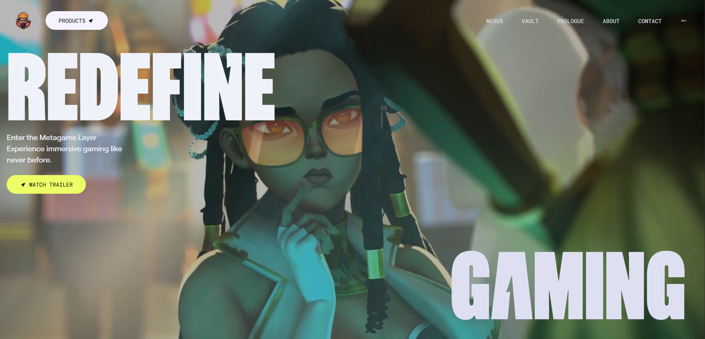

# 🎮 Gaming Website – Immersive Gaming Frontend
# Designed & Developed by Shivam Kumar
                   © 2026 Shivam Kumar. All Rights Reserved.

A modern, award-style **gaming frontend website** built using **Vite + React**, styled with **Tailwind CSS**, and enhanced with **GSAP animations** for smooth, cinematic user interactions.

This project focuses on **high-end UI/UX**, **motion design**, and **performance-optimized frontend architecture**.

🔗 **Live Demo:** https://cyber-play-gaming.vercel.app/

---

## 🚀 Tech Stack

* **Vite** – Lightning-fast build tool
* **React** – Component-based UI development
* **Tailwind CSS** – Utility-first styling
* **GSAP** – Professional-grade animations
* **PostCSS** – CSS processing
* **ESLint** – Code quality & consistency

---

## ✨ Key Features

* 🎬 Cinematic hero sections with bold typography
* ⚡ Smooth GSAP animations & transitions
* 🎨 Modern gaming / metaverse-inspired UI
* 📱 Fully responsive design
* 🧩 Reusable React components
* 🚀 Fast load times with Vite bundling

---

## 📁 Project Structure

```
AWWARD/
├── node_modules/        # Project dependencies
├── public/              # Static assets
├── src/                 # Application source code
│   ├── components/      # Reusable React components
│   ├── pages/           # Page sections (Hero, Vault, Nexus, etc.)
│   ├── animations/      # GSAP animation logic
│   ├── assets/          # Images, icons, media
│   ├── App.jsx          # Main App component
│   └── main.jsx         # Entry point
├── SS/                  # Screenshots / UI previews
├── index.html           # Root HTML file
├── tailwind.config.js   # Tailwind configuration
├── postcss.config.js    # PostCSS configuration
├── eslint.config.js     # ESLint rules
├── vite.config.js       # Vite configuration
├── package.json         # Project metadata & scripts
├── package-lock.json    # Dependency lock file
└── README.md            # Project documentation
```

---

## 🛠️ Installation & Setup

### 1️⃣ Clone the Repository

```bash
git clone https://github.com/shivam-jha-89/CyberPlay-Gaming
```

### 2️⃣ Navigate to the Project

```bash
cd gameWebsite
```

### 3️⃣ Install Dependencies

```bash
npm install
```

### 4️⃣ Run Development Server

```bash
npm run dev
```

👉 App runs on: **[http://localhost:5173](http://localhost:5173)**

---

## 🎞️ GSAP Animations

This project uses GSAP for:

* Scroll-based animations
* Text reveal effects
* Section transitions
* Smooth hover & interaction effects

Animations are optimized for **performance and smoothness**.

---

## 📸 Screenshot



---

## 🎯 Purpose of the Project

* Showcase **advanced frontend skills**
* Demonstrate **React + Tailwind best practices**
* Build an **award-style gaming UI**
* Practice **GSAP-driven motion design**
* Create a **portfolio-ready project**

---

## 🔮 Future Improvements

* 🎥 Video-based hero sections
* 🕹️ Interactive game-style navigation
* 🔊 Sound effects for interactions

---

## 📜 License

This project is created for **learning, portfolio, and demonstration purposes**.

